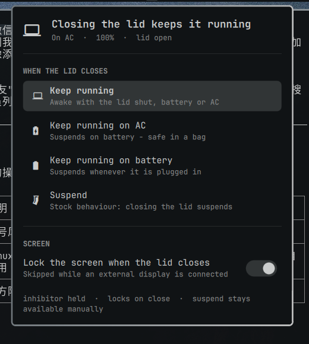

# Laptop Lid

An Omarchy shell plugin that decides what closing the laptop lid does, from the
bar: keep running, keep running only on AC, keep running only on battery, or
suspend normally.



## Why this exists

The obvious way to keep a laptop awake with the lid shut is a `logind` drop-in:

```ini
# /etc/systemd/logind.conf.d/something.conf
[Login]
HandleLidSwitch=ignore
```

That is a system file, so every change needs root, and on a machine without a
polkit agent it means a password prompt in a terminal. It is also one-way: with
`ignore` set there is no way back to suspend without editing root files again.

`logind` asks inhibitors before it acts, so this plugin holds a
`handle-lid-switch` inhibitor instead:

```bash
systemd-inhibit --what=handle-lid-switch --mode=block \
  --who="Omarchy lid policy" --why="..." sleep infinity
```

No privileges, instant toggling, and the inhibitor lives exactly as long as the
process holding it. If the shell crashes or you log out, the lid goes back to
the stock behaviour instead of leaving a laptop cooking in a bag.

## Modes

| Mode | On AC | On battery |
| --- | --- | --- |
| Keep running | awake | awake |
| Keep running on AC | awake | suspend |
| Keep running on battery | suspend | awake |
| Suspend | suspend | suspend |

The first three are opt-in. Out of the box the plugin is in **Suspend**, exactly
logind's default (`HandleLidSwitch=suspend`), so merely installing it changes
nothing until a mode is picked. "Suspend" here means the normal sleep-to-RAM
(`s2idle` on modern laptops) — the same thing as `systemctl sleep` unless a
`SleepOperation=` is configured.

The bar glyph shows what will actually happen: a laptop while an inhibitor is
held, a crossed-out laptop when closing the lid will suspend. Tooltip says it in
words.

## Lock on lid close

An inhibitor blocks `logind`'s whole lid action, including the lock-before-suspend
that Omarchy normally gets. Left alone, an awake closed lid would unlock on
open, so the plugin watches the ACPI lid switch itself and runs
`omarchy system lock` — except while an external display is connected, because
then closing the lid is docking, not walking away. The toggle is in the panel.

The lid switch is read from `/proc/acpi/button/lid/*/state`, with a 3 second
poll only while an inhibitor is held and the lock toggle is on. procfs inotify
is not dependable across firmwares, so the timer is the safety net.

## Requirements

- A laptop with an ACPI lid switch (`/proc/acpi/button/lid/*/state`).
- `systemd-inhibit` (systemd) and `hyprctl` (Hyprland) — both already on Omarchy.
- **No `HandleLidSwitch=ignore` drop-in.** The panel warns if one exists,
  because it would outrank the plugin and make "Suspend" do nothing. Remove
  `/etc/systemd/logind.conf.d/30-lid-ignore.conf` and
  `sudo systemctl reload systemd-logind` if this plugin replaced a manual fix.

## Install

```bash
omarchy plugin add https://github.com/hominluo/omarchy-laptop-lid --enable
```

or, for local development, keep the repo in place and symlink it:

```bash
ln -s ~/.config/omarchy/plugins/io.github.hominluo.lid ~/Github/Omarchy/omarchy-laptop-lid
```

The plugin stores its choice in
`~/.local/state/omarchy/lid-policy/state.json` and re-applies it at shell start.

## Files

| File | Purpose |
| --- | --- |
| `manifest.json` | Plugin manifest: one `bar-widget` entry point |
| `Panel.qml` | Bar item, panel, inhibitor process, state, lid watcher |

## Uninstall

`omarchy plugin remove io.github.hominluo.lid`. Stock lid behaviour returns by
itself — nothing outside your config was ever touched.

## License

MIT
